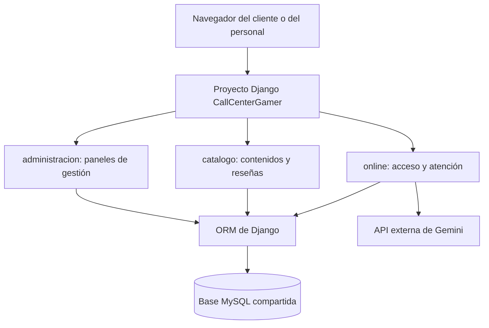
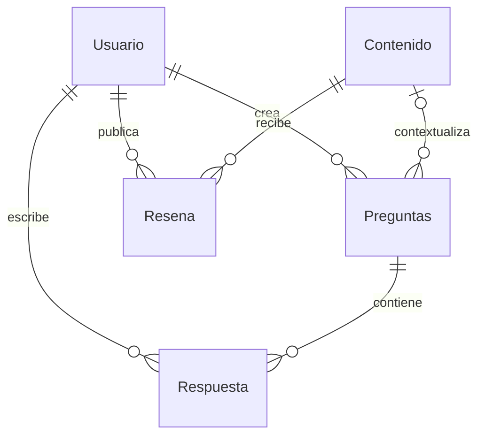

# Documentación técnica de la integración de Entel TV

Evaluación Sumativa N.º 3, Parte 2 — Programación Back End  
Docente: Boris Astorga Parraguez  
Fecha: 17 de noviembre de 2026

## Introducción

Entel TV es una aplicación web académica que integra un catálogo de películas
y series con un sistema de atención al cliente. El desarrollo reúne el sistema
CallCenterGamer trabajado por el equipo y los patrones de catálogo y gestión
de películas del proyecto de referencia entregado por el docente.

La integración permite que un cliente consulte una obra, publique una reseña
y cree una solicitud de ayuda vinculada a ese contenido. El ejecutivo puede
abrir la ficha desde el ticket, responder y conservar la conversación.
La plataforma también ofrece un asistente virtual opcional mediante Gemini.

## Objetivo

Integrar catálogo y atención al cliente en una misma plataforma Django, con
autenticación compartida, relaciones entre sus datos y persistencia en MySQL.
La personalización visual se inspira en Entel TV Chile y mantiene un alcance
académico: no ofrece reproducción audiovisual ni servicios comerciales.

## Arquitectura del sistema

Se utilizó CallCenterGamer como proyecto principal y se incorporó el catálogo
como una aplicación interna. El resultado contiene un único `manage.py`, una
configuración central, un servidor Django y una base de datos compartida.

Esta organización permite reutilizar el usuario personalizado y las sesiones,
y vincular contenidos, tickets y reseñas mediante claves foráneas. También
evita mantener autenticaciones duplicadas o comunicar dos servidores separados.

Las aplicaciones internas se integran mediante vistas, modelos y consultas
del ORM. No se utiliza una API REST propia ni JWT para comunicarlas.
Las respuestas JSON para actualizar mensajes y consultar al asistente usan
la misma autenticación de sesión del proyecto.

| Componente | Responsabilidad |
|---|---|
| `CallCenterGamer` | Configuración, rutas generales, entradas WSGI/ASGI y perfil aislado de pruebas. |
| `online` | Usuario personalizado, registro, inicio de sesión, tickets, mensajes y conexión con Gemini. |
| `catalogo` | Películas y series, filtros, fichas, reseñas, administración del catálogo y precarga. |
| `administracion` | Panel administrativo, bandeja técnica compartida, gestión de usuarios, edición de tickets y estadísticas. |

Se conservaron los nombres técnicos existentes para mantener las rutas,
importaciones y migraciones compatibles.

## Tecnologías utilizadas

| Tecnología | Versión verificada | Uso |
|---|---|---|
| Python | 3.11.9 | Lenguaje del servidor. |
| Django | 5.2.17 | Modelos, formularios, vistas, sesiones, administración y pruebas. |
| MySQL | 8.4.13 | Persistencia utilizada en la comprobación funcional integrada. |
| mysqlclient | 2.3.0 | Conexión de Django con MySQL. |
| Pillow | 12.3.0 | Validación de imágenes cargadas mediante formularios. |
| Bootstrap | 5.3.3 | Componentes y adaptación de la interfaz; recursos locales. |
| HTML, CSS y JavaScript | Recursos del proyecto | Plantillas, estilos, filtros visuales, asistente y actualización de mensajes. |
| SQLite | Perfil aislado de Django | Pruebas automatizadas sin utilizar MySQL. |

Gemini se consulta mediante `urllib.request`, de la biblioteca estándar de
Python. Las dependencias directas de la entrega se declaran en
`requirements.txt`.

## Modelos y relaciones

El sistema conserva los modelos `Usuario`, `Preguntas` y `Respuesta` del
Call Center. El catálogo incorpora `Contenido` y `Resena`.

| Modelo | Datos y función principal |
|---|---|
| `Usuario` | Identificación, correo, datos personales y casillas independientes `admin`, `tecnico` y `activo`. |
| `Contenido` | Título, tipo película/serie, género principal, año, sinopsis, imagen y estado activo. Su identificador es UUID. |
| `Preguntas` | Título, consulta inicial, propietario, fecha, categoría, estado y contenido opcional. Representa un ticket. |
| `Respuesta` | Ticket, autor, texto y fecha/hora de cada mensaje de la conversación. |
| `Resena` | Contenido, autor, calificación de 1 a 5, comentario y fecha de creación. |

La relación `Preguntas.contenido` admite valores nulos. Así se mantienen los
tickets generales y los registros anteriores a la integración. Esta clave
foránea utiliza `PROTECT`, al igual que las relaciones de reseña con usuario
y contenido.

Una restricción única impide que un usuario publique más de una reseña del
mismo contenido. Una restricción CHECK limita la calificación a valores entre
1 y 5. Los formularios complementan esas reglas con mensajes de validación.

Las relaciones originales entre usuarios, tickets y respuestas conservan su
definición. La protección del historial en las interfaces se realiza mediante
desactivación de cuentas y bloqueo de la eliminación de tickets y mensajes;
no se afirma que todas las relaciones originales tengan `PROTECT`.

## Autenticación y permisos

El proyecto mantiene `AUTH_USER_MODEL = 'online.Usuario'`. El registro público
crea cuentas activas sin permisos administrativos ni técnicos, aunque una
solicitud intente incluir esos campos.

Las casillas `admin`, `tecnico` y `activo` no representan roles excluyentes.
Un administrador puede ser también técnico. El superusuario conserva ambas
capacidades y puede gestionar los perfiles desde Django Admin.

| Usuario | Accesos principales |
|---|---|
| Visitante | Inicio de sesión y registro. |
| Cliente activo | Catálogo, reseñas propias, asistente y sus tickets y conversaciones. |
| Técnico activo | Bandeja compartida, consulta de tickets, respuestas y actualización de estados. |
| Administrador activo | Paneles administrativos, usuarios y gestión del catálogo. |
| Cuenta inactiva | Sin acceso a funciones protegidas, incluso con una sesión anterior. |

Los permisos se verifican en el servidor. Las operaciones de escritura
utilizan POST y protección CSRF. El inicio de sesión conserva un destino
`next` interno válido; en su ausencia, el cliente llega al catálogo, el
técnico a su escritorio y el administrador a su panel.

## Integración del catálogo y el Call Center

El flujo principal funciona de la siguiente manera:

1. El cliente autenticado consulta la ficha de una película o serie activa.
2. Selecciona Solicitar ayuda y accede al centro de ayuda contextual.
3. Puede crear directamente un ticket o utilizar el asistente opcional.
4. Al crear el ticket, la vista valida el contenido de la ruta y asigna
   propietario, fecha y relación en el servidor.
5. El ejecutivo encuentra la solicitud en la bandeja compartida y abre la
   ficha del contenido desde el propio ticket.
6. El ejecutivo responde y el cliente puede consultar el historial y continuar
   la conversación.

Los identificadores inexistentes o manipulados y los contenidos inactivos se
rechazan al crear nuevas solicitudes relacionadas. El centro de ayuda general
permite crear tickets sin película ni serie asociada.

La ficha normal de un contenido inactivo no está disponible en el catálogo.
Su consulta desde un ticket requiere que el usuario sea su propietario o
personal autorizado. En ese caso se muestra «Contenido no disponible» y la
ficha es de solo lectura, sin nuevas reseñas ni solicitudes asociadas.
Se reutiliza el registro conservado; no existe un sistema de versiones de fichas.

## Catálogo y reseñas

El catálogo inicial contiene exactamente 20 películas y 10 series de
demostración. Los listados muestran únicamente contenidos activos y permiten
buscar por título, combinar filtros por tipo, género y año, y ordenar
alfabéticamente o por año en ambos sentidos.

El panel propio del catálogo permite crear, editar, desactivar y reactivar
contenidos. Exige una cuenta activa con permiso `admin`. La baja lógica
conserva las reseñas, tickets y conversaciones relacionados.

La ficha presenta portada, metadatos, sinopsis, reseñas, promedio y cantidad
de valoraciones. El autor puede editar o eliminar su propia reseña mientras
el contenido esté activo. La desactivación y reactivación conservan las
reseñas existentes.

El comando `precargar_catalogo` obtiene los datos de `catalogo/datos_iniciales.json`
y utiliza UUID deterministas junto con `get_or_create`. Solo inserta registros
faltantes y copia sus portadas; una ejecución posterior no duplica contenidos
ni reemplaza las modificaciones del administrador. La carga no ocurre durante
las visitas al catálogo.

## Tickets y conversaciones

Los tickets mantienen las categorías Cuenta y acceso, Películas y series,
Problemas técnicos y Otros. Los valores anteriores se conservan para consultar
el historial. Los estados siguen siendo Abierto, En proceso y Cerrada.

La consulta inicial pertenece al modelo `Preguntas` y los mensajes posteriores
a `Respuesta`. Cada intervención conserva su autor y fecha. El personal
trabaja con una bandeja compartida, sin asignación individual de tickets.

El navegador consulta los mensajes cada dos segundos mediante una ruta
protegida. El JavaScript utiliza `textContent` para mostrar el texto.
Los clientes acceden únicamente a sus solicitudes; el personal autorizado
puede atenderlas y consultar sus contenidos relacionados.

## Asistente virtual

El asistente aparece como una burbuja en la esquina inferior derecha de las
pantallas del cliente. Permanece cerrado inicialmente y comparte un único
componente de plantilla, hoja de estilos y script.

Su proveedor interno es Gemini. Se conserva el modelo
`gemini-3.5-flash-lite` y un tiempo de espera de 20 segundos en el servidor.
La clave se obtiene exclusivamente de `GEMINI_API_KEY`. Debe configurarse
antes de iniciar Django en la misma terminal que ejecutará el servidor.

La petición incluye la consulta actual y datos públicos acotados de hasta
30 contenidos activos. Si corresponde, añade el contenido seleccionado que
no estuviera en esa muestra, con un máximo de 31. Las sinopsis se limitan a
200 caracteres en ese contexto. El servidor no incorpora contraseñas, RUT,
perfiles privados, tickets ni conversaciones guardadas.

La interfaz advierte que el usuario no debe escribir datos sensibles, porque
el texto de su consulta sí se transmite al proveedor. Las instrucciones del
asistente distinguen el catálogo académico de la disponibilidad comercial real
de Entel TV.

Las respuestas se presentan como texto. El historial visual del asistente
solo permanece en la página: no se implementan memoria avanzada, almacenamiento
del chat de IA ni creación automática de tickets. La atención humana siempre
está disponible, aunque falte la clave o falle el proveedor.

## Base de datos y configuración

MySQL almacena los usuarios, contenidos, reseñas, tickets, respuestas y tablas
internas de Django. Las nuevas relaciones se incorporaron mediante migraciones,
manteniendo las cinco migraciones originales del Call Center y la inicial
del catálogo. La base utilizada en la comprobación integrada tiene 26
migraciones aplicadas, incluidas las del framework.

La entrega utiliza variables de entorno para `DB_NAME`, `DB_USER`,
`DB_PASSWORD`, `DB_HOST`, `DB_PORT`, `DJANGO_SECRET_KEY` y `GEMINI_API_KEY`.
No contiene credenciales personales ni una base privada exportada.
`DJANGO_SECRET_KEY` es obligatoria en la configuración normal. El proyecto
no carga automáticamente archivos `.env`.

Las imágenes originales de la precarga se conservan en `static` y las imágenes
asociadas a registros se almacenan bajo `media`. Son responsabilidades distintas.
Las instrucciones de instalación y ejecución están en el [README](../README.md).

## Decisiones técnicas y visuales

La separación en aplicaciones permite conservar las responsabilidades de cada
componente y compartir los datos mediante Django. Se mantiene el modelo de
usuario existente, la baja lógica y el historial de atención. La elección
evita duplicar autenticación, tickets o conversaciones.

La interfaz utiliza fondos oscuros, texto claro, tarjetas audiovisuales y
acentos rosados. Los estilos son propios y se basan en referencias públicas
de Entel TV Chile; no se atribuyen al CSS original del servicio.
Django Admin conserva su diseño convencional.

Bootstrap y los recursos de presentación se distribuyen localmente. Las
portadas son ilustraciones referenciales originales, no afiches oficiales.
Las fuentes de los contenidos y condiciones de uso se detallan en
[Fuentes y licencias](Fuentes_y_Licencias.md).

## Verificación del funcionamiento

Los siguientes resultados corresponden a la comprobación integrada del proyecto:

| Comprobación histórica | Resultado |
|---|---|
| Pruebas automatizadas en SQLite aislado | 142 aprobadas. |
| Comprobaciones funcionales sobre MySQL | 49 satisfactorias, con MySQL 8.4.13. |
| Migraciones en la base utilizada | 26 aplicadas. |
| Catálogo inicial | 20 películas y 10 series. |
| Asistente con Gemini real | Funcionamiento comprobado manualmente por la responsable del proyecto. |

La comprobación manual de Gemini se diferencia de las pruebas automatizadas,
que emplean respuestas simuladas. Las verificaciones específicas de la copia
de entrega se presentan por separado en [Evidencias](Evidencias.md).
Las capturas identifican el entorno SQLite o MySQL en que se obtuvieron.

## Conclusión

La integración reúne catálogo y atención al cliente mediante una autenticación,
una base compartida y relaciones entre contenidos, tickets y reseñas.
El flujo permite pasar de la ficha a una solicitud, abrir el contenido desde
el ticket y conservar la conversación con el ejecutivo.

La solución reutiliza las funcionalidades del Call Center y adapta el catálogo
del docente al contexto de Entel TV. Su alcance demuestra integración,
persistencia, permisos y personalización temática sin incorporar reproducción,
pagos, suscripciones, temporadas, capítulos ni una arquitectura comercial.
