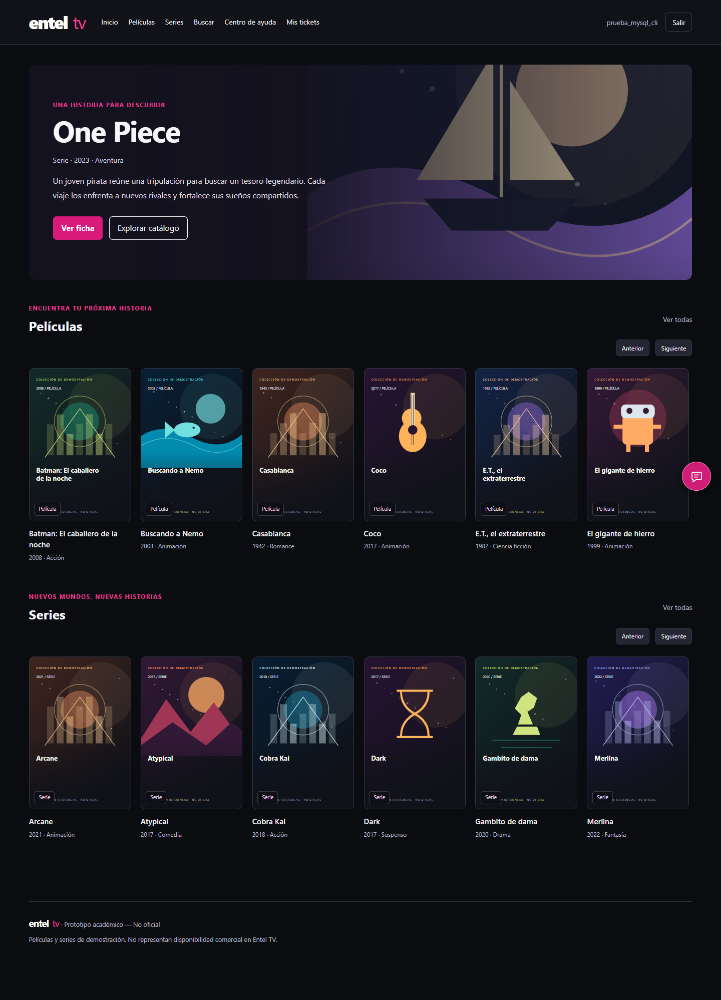
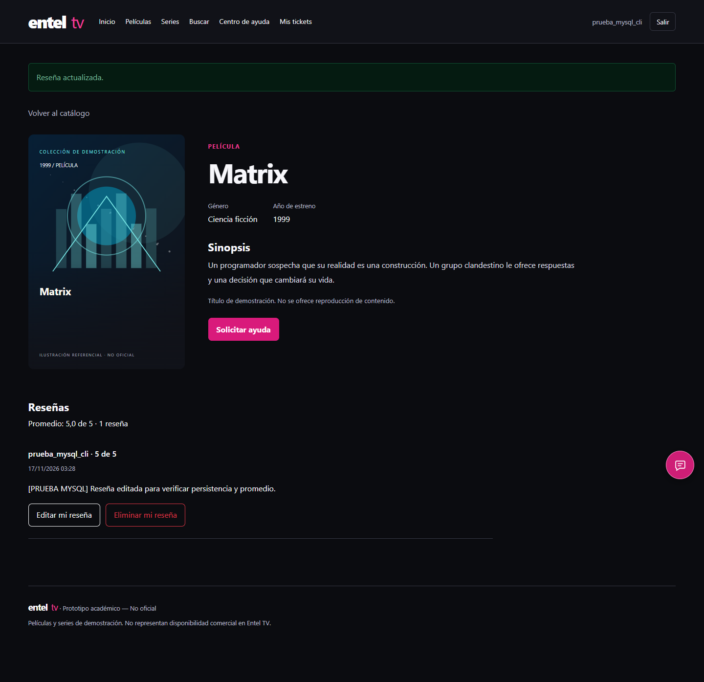
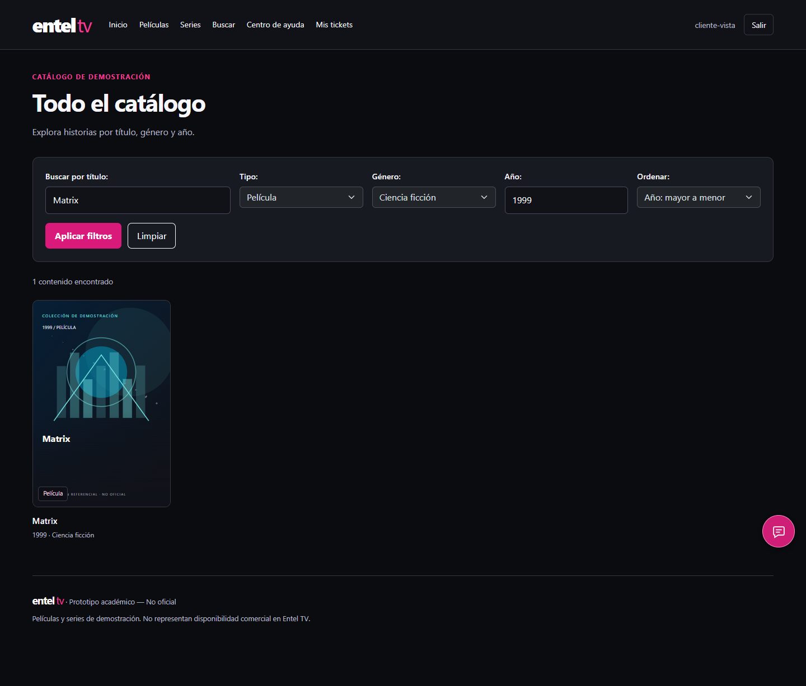
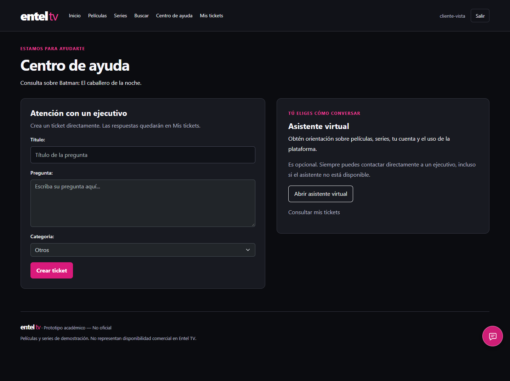
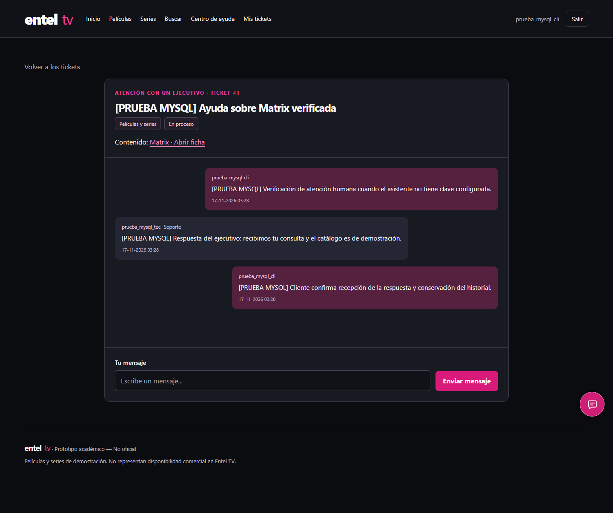
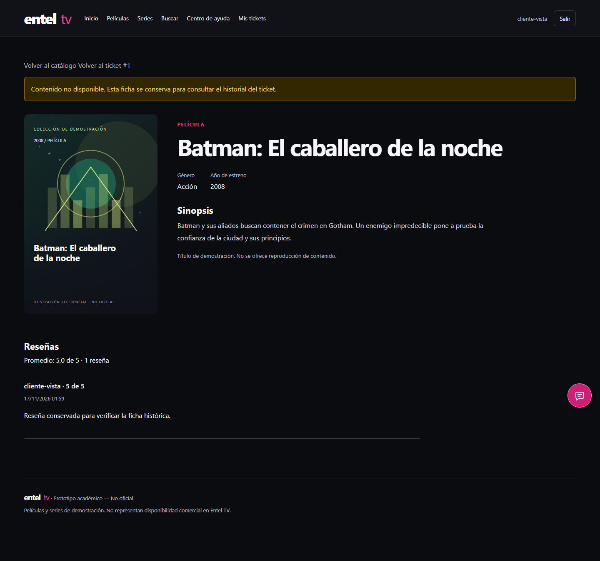
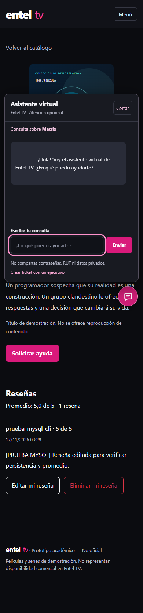
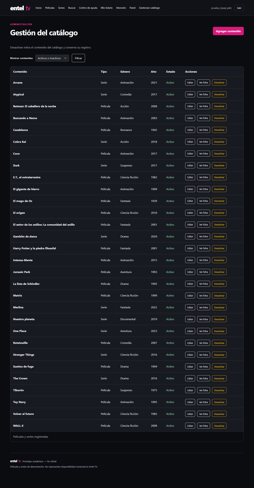

# Evidencias y verificación del proyecto

## Resultados de la comprobación integrada

| Entorno y modalidad | Resultado registrado |
|---|---|
| SQLite aislado, pruebas automatizadas | 142 pruebas aprobadas. |
| MySQL 8.4.13, comprobación funcional | 49 comprobaciones satisfactorias y 26 migraciones aplicadas en la base utilizada. |
| Catálogo de demostración | 20 películas y 10 series. |
| Gemini real, comprobación manual | Funcionamiento confirmado manualmente por la responsable del proyecto. |

La comprobación manual de Gemini no forma parte de las pruebas automatizadas.
Las capturas siguientes corresponden a recorridos previamente ejecutados y
se identifican por su entorno. No se presentan respuestas simuladas ni errores
controlados como demostración de una respuesta real del proveedor.

## Catálogo principal en MySQL

Figura 1. Inicio del catálogo, destacado y filas de películas y series.
Entorno: MySQL real, cuenta sintética de comprobación.

## Ficha y reseñas en MySQL

Figura 2. Ficha de Matrix con metadatos, sinopsis, acceso a ayuda y reseña
de una cuenta sintética. Entorno: MySQL real.

## Búsqueda y filtros en SQLite

Figura 3. Búsqueda de Matrix combinada con tipo, género, año y orden.
Entorno: SQLite temporal aislado; interfaz final del proyecto.

## Solicitud relacionada con un contenido en SQLite

Figura 4. Formulario para crear un ticket desde la ficha de Batman:
El caballero de la noche. El centro de ayuda conserva el contenido y
permite atención humana directa. Entorno: SQLite temporal aislado.

## Conversación e historial en MySQL

Figura 5. Ticket relacionado con Matrix, estado En proceso, consulta inicial
y respuestas del ejecutivo y del cliente. Se conserva el enlace a la ficha.
Entorno: MySQL real; textos identificados como prueba.

## Ficha histórica desde un ticket en SQLite

Figura 6. Consulta de un contenido desactivado desde un ticket relacionado,
con el aviso «Contenido no disponible» y enlace de regreso al ticket.
Entorno: SQLite temporal aislado.

## Asistente contextual en móvil sobre MySQL

Figura 7. Burbuja abierta en la ficha de Matrix, con contexto del contenido,
entrada de consulta y acceso a un ejecutivo. Entorno: MySQL real.
Esta imagen muestra la interfaz y el contexto; no acredita una respuesta
real de Gemini.

## Administración del catálogo en MySQL

Figura 8. Panel propio con contenidos, estado y acciones de administración.
Entorno: MySQL real, cuenta administrativa sintética.

## Verificación de la copia de entrega

La copia se instaló en un entorno virtual nuevo de Python 3.11.9 mediante
`requirements.txt`. Se instalaron Django 5.2.17, mysqlclient 2.3.0 y Pillow
12.3.0, junto con sus dependencias transitivas. `pip check` no informó
incompatibilidades. OpenAI y django-environ no están instalados en ese entorno.

| Comprobación de la copia | Resultado |
|---|---|
| Suite de pruebas automatizadas | 142 ejecutadas y aprobadas; sin fallos, errores ni omisiones. |
| Aislamiento | SQLite en memoria; importación de MySQL y conexiones externas bloqueadas. |
| Configuración | Credenciales predeterminadas neutras y `DJANGO_SECRET_KEY` obligatoria en el perfil normal. |
| Modelos y migraciones | Sin migraciones faltantes; 26 migraciones aplicadas únicamente a SQLite de comprobación. |
| Precarga | 20 películas, 10 series e imágenes disponibles; segunda ejecución sin duplicados ni cambios. |
| Código y plantillas | Sintaxis e importaciones revisadas y plantillas compiladas sin errores. |
| Recursos y documentación | Estáticos resueltos localmente y enlaces incluidos comprobados. |
| Flujo integrado | Catálogo, reseña, ticket relacionado, respuesta humana, ficha desde ticket y paneles comprobados con datos sintéticos. |
| Asistente | Respuesta simulada y ausencia de clave comprobadas; atención humana disponible. |

Esta ejecución sobre la copia es adicional a las 142 pruebas históricas.
No se modificó ni consultó MySQL y no se realizaron llamadas reales a Gemini.
La prueba manual del proveedor real indicada al inicio corresponde a la
comprobación integrada anterior del proyecto.

Las ocho capturas conservan sus archivos originales. Su contenido visible
incluye cuentas y textos sintéticos de verificación; no muestra contraseñas,
claves API ni datos personales de las cuentas originales.
